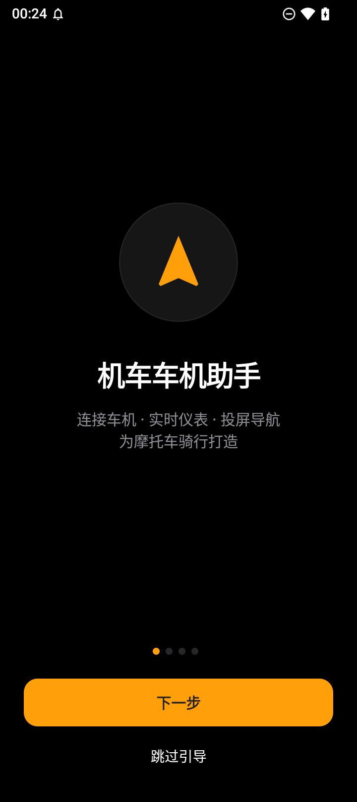
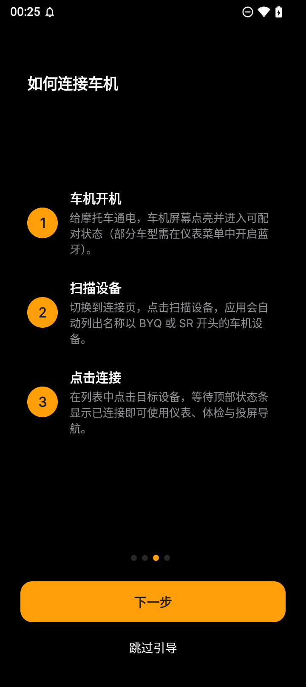
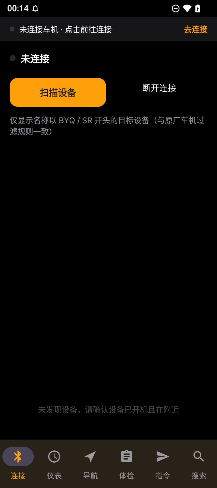
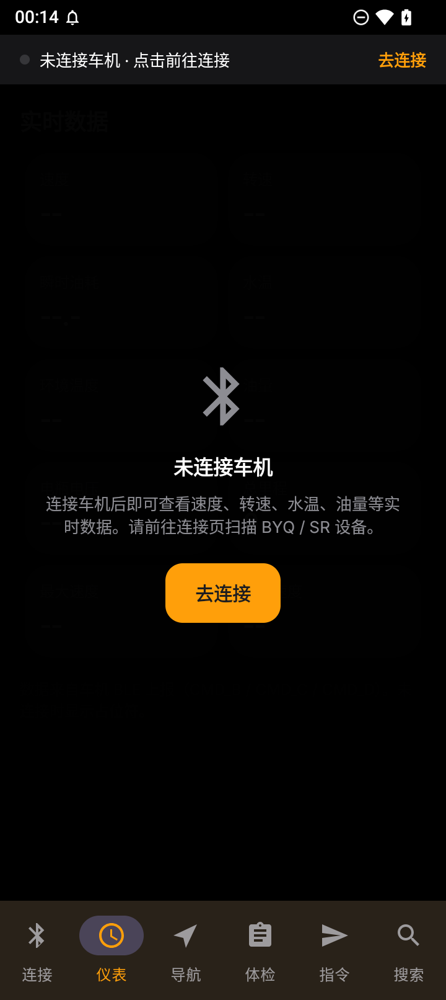
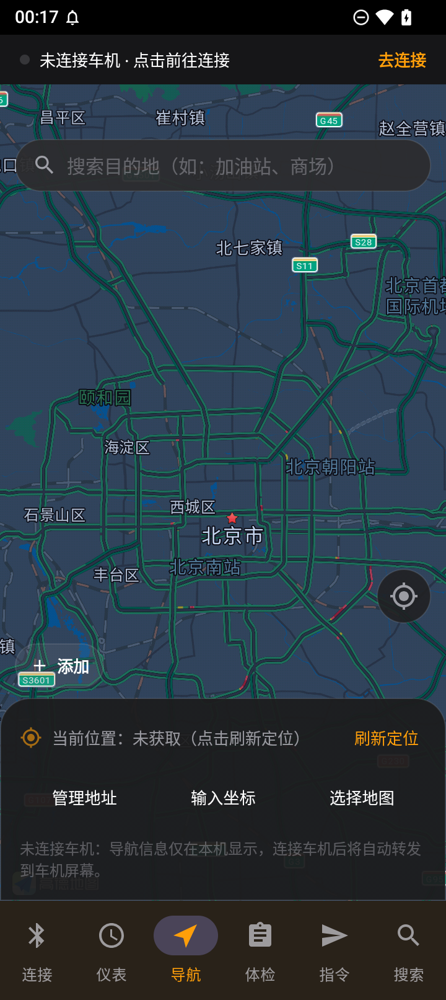
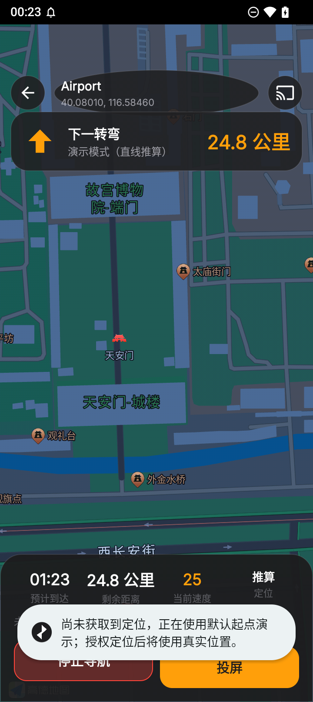
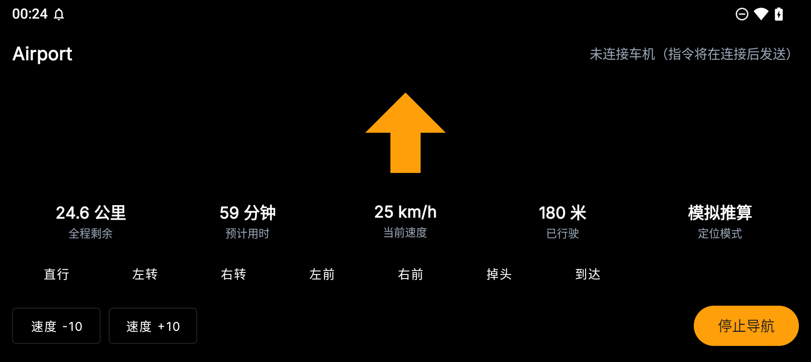

# 机车车机助手 · MotoHUD Bridge

面向**支持 BLE 车机互联的摩托车仪表**的 Android 工具：把手机的车辆数据、体检结果、导航信息，通过蓝牙推到车机屏幕上。

> 本项目独立开发，与任何整车厂商、车机厂商均无从属关系，也不包含其任何代码、图片或资源。

---

## 功能

| 模块 | 说明 |
| --- | --- |
| **连接** | 扫描并连接车机（自动过滤 `BYQ*` / `SR*` 与 `860745020*` 三类设备名），兼容双协议栈（FastBLE 服务 `00003719` + legacy GATT `0000ff33`），掉线自动重连 |
| **仪表** | 实时速度、转速、瞬时油耗、水温、环境温度、油量、电瓶电压、总里程、最大/平均速度 |
| **体检** | 开关状态位（ABS/OBD/电瓶/胎压/燃油/机油压力/保养/主控）+ ECU 故障码 + OBD 故障码 |
| **指令** | 按设备类型自动选择码表发送导航指令（转向图标 + 全程剩余 + 下一转弯剩余）、握手、到达、自定义文本、通知推送测试 |
| **导航** | 高德地图展示 + 目的地搜索（POI 输入提示）+ 驾车路线规划 + 转向引导（TTS 播报）+ 路线跟随；常用地址（家/公司/自定义）**点击即开始导航** |
| **投屏** | 导航中一键切到横屏 HUD 大字体界面，同时把转向图标与剩余距离实时写入车机（`REM/NEXT/NAVI` 或 `NA/RE/NE`），到达发 `FINISH`，退出发 `NO` |
| **搜索** | 本地检索故障码、指令、关键词，带历史记录 |
| **通知转发** | 可选：把微信/LINE/短信/来电推到车机提示（需手动授予通知使用权） |

首次启动提供 4 步新手引导（欢迎 → 隐私政策 → 如何连接车机 → 如何开始导航），之后可在「设置 → 重新查看新手引导」再次查看。

---

## 适用设备

- 具备 BLE 仪表 / 车机互联能力的摩托车，实测为**比亚乔（Piaggio）**系列随车 BLE 仪表；
- 连接页按设备名前缀自动识别：`BYQ*`、`SR*`，以及 MAC 前缀 `860745020*`；
- 其他品牌只要符合文末「协议要点」，改动 `ScanFragment` 的过滤规则即可适配。

---

## 界面

暗色玻璃设计（tvOS 风格），主色 `#FF9F0A`：6 个页签 + 顶部连接状态条
（灰点未连接 / 橙点连接中 / 绿点已连接并显示设备名），未连接的页签显示空态遮罩并提供「去连接」入口。

| 新手引导 | 连接车机 | 连接页 |
| --- | --- | --- |
|  |  |  |

| 仪表（未连接） | 地图与搜索 | 导航中 | 投屏 HUD |
| --- | --- | --- | --- |
|  |  |  |  |

---

## 快速开始

### 1. 编译

```bash
# 需要 JDK 17、Python 3 与 Android SDK（compileSdk 36）

# ① 准备高德 SDK：下载 → 合并去重 → 解出 so 与 assets（SDK 不进仓库）
python tools/prepare_amap_sdk.py

# ② 编译
./gradlew assembleDebug
# 产物：app/build/outputs/apk/debug/app-debug.apk
```

首次编译前在项目根目录创建 `local.properties`：

```properties
sdk.dir=/path/to/Android/Sdk
amap.apiKey=你的高德Key      # 可选，也可在应用内填写
```

> 高德官方只把类 jar 发布到 Maven，`.so` 与 `assets` 都打包在 jar 内部，
> Gradle 不会自动处理，所以需要第 ① 步。SDK 版权归高德所有，仓库不分发。

### 2. 地图与搜索（可选但推荐）

地图、目的地搜索、路线规划由**高德开放平台** SDK 提供，需要自行申请 Key：

1. 打开 <https://lbs.amap.com>，创建应用 → 添加 Key → 选择 **Android 平台**；
2. 包名填 `com.motohud.ble`，SHA1 填你签名证书的指纹（debug 包可用 `keytool -list -v -keystore ~/.android/debug.keystore` 查看）；
3. 到「服务管理」开通 **地图 SDK**、**搜索**、**定位** 三项；
4. 把 Key 粘贴到应用内「导航 → 去配置」或「设置 → 高德地图 Key」。

未配置 Key 时：地图区域隐藏，POI 搜索不可用，但**蓝牙投屏导航仍可用**
（引擎按直线推算演示转向与剩余距离，方便验证车机链路）。

### 3. 使用

1. 摩托通电，车机进入可配对状态；
2. 「连接」页 → 扫描设备 → 点击目标设备；
3. 顶部状态条变绿即连接成功，仪表 / 体检 / 指令页即时可用；
4. 「导航」页搜索目的地或点击「家 / 公司」→ 自动规划路线并开始导航；
5. 导航中点右上角「投屏」→ 车机屏幕显示转向图标与剩余距离。

---

## 权限说明

| 权限 | 用途 |
| --- | --- |
| 蓝牙（`BLUETOOTH_SCAN` / `CONNECT`，Android 12+） | 连接车机 |
| 定位（`ACCESS_FINE_LOCATION`） | 导航定位；Android 11 及以下扫描 BLE 也需要 |
| 通知（`POST_NOTIFICATIONS`） | 前台服务与到达提醒 |
| 通知使用权（可选） | 把手机通知转发到车机，需在系统设置中手动开启 |

车辆数据只在本地处理，不上传任何服务器；常用地址与搜索历史存在本机数据库。

---

## 协议要点（便于适配其他车机）

下行帧：`[0..4) 命令 hex | [4..6) 数据长度 | [6..) 数据`

- `CMD_A` 开关位域、`CMD_B/C` 速度/转速/油耗/水温/油量/电瓶、`CMD_D` 里程、`CMD_E/F` 故障码
- 无效值一律 `fffe`

上行文本指令（`:` → `0x1E`，首尾 `0x0D`）：

- SR 类：`REM :全程剩余::`、`NEXT :下一转弯::`、`NAVI :图标::`
- BYQ 类：`NA`、`RE`、`NE`
- 握手：`HELLO :A:<品牌>:`
- 到达：`FINISH :::`；退出：`NO`

转向图标沿用高德 `IconType` 数值（直行 9 / 左转 2 / 右转 3 / 左前 4 / 右前 5 / 掉头 8 / 到达 15），
与主流导航软件的车机投屏数据一致。

---

## 目录结构

```
app/src/main/java/com/motohud/ble/
├── amap/       高德 SDK 封装（Key/隐私合规、POI 提示、驾车路线规划）
├── ble/        GATT 连接管理、协议编解码、导航指令
├── data/       Room（常用地址、搜索历史）、故障码库、本地检索
├── navi/       路线引导引擎、图标映射、坐标转换、指令转发器
├── service/    通知转发服务
└── ui/         主界面（6 页签）、导航页、导航中界面、新手引导
```

---

## 免责声明

- 本项目为个人自用工具，按「现状」提供，不对车辆、车机或人身安全作任何保证。
- **骑行中请勿操作手机**；投屏信息仅供参照，实际路况以现场为准。
- 车机型号、固件差异可能导致部分指令无效，请先在静止状态验证。
- 地图与搜索服务由高德开放平台提供，可用性与配额以官方为准。

## 许可证

MIT，见 [LICENSE](LICENSE)。字体 Inter 依 SIL Open Font License 1.1 分发，见 [app/FONT-LICENSE-OFL.txt](app/FONT-LICENSE-OFL.txt)。
