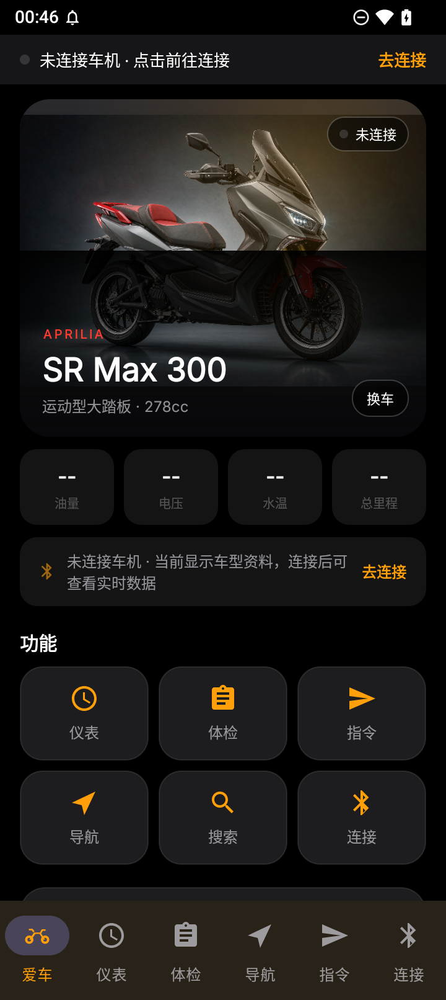
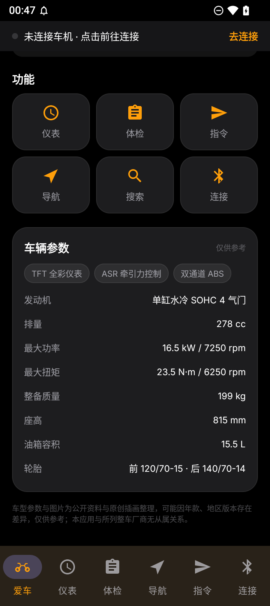
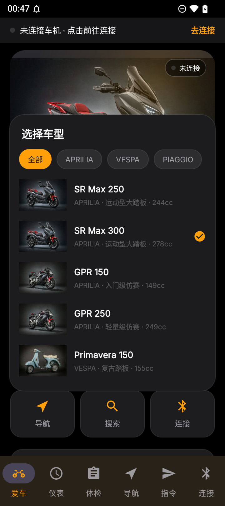
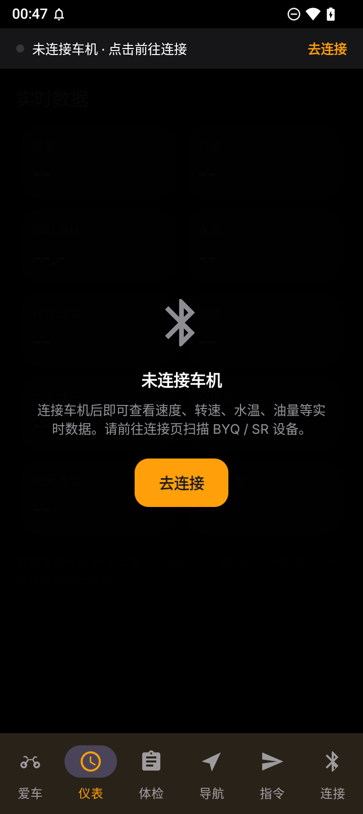
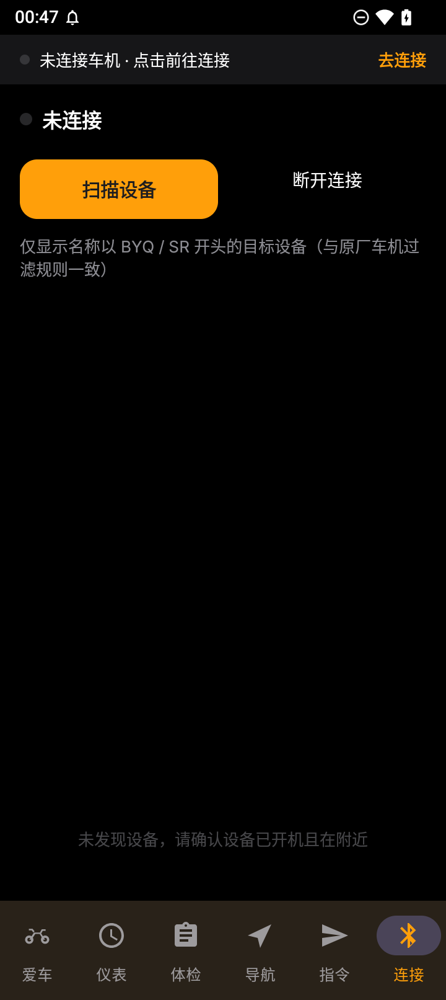
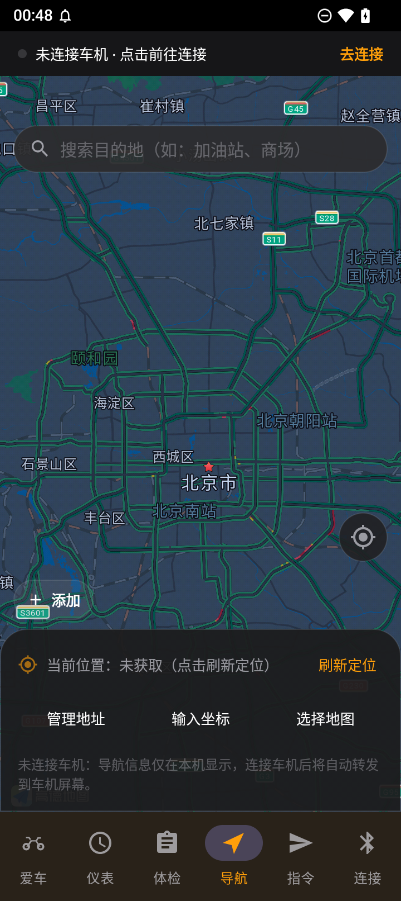
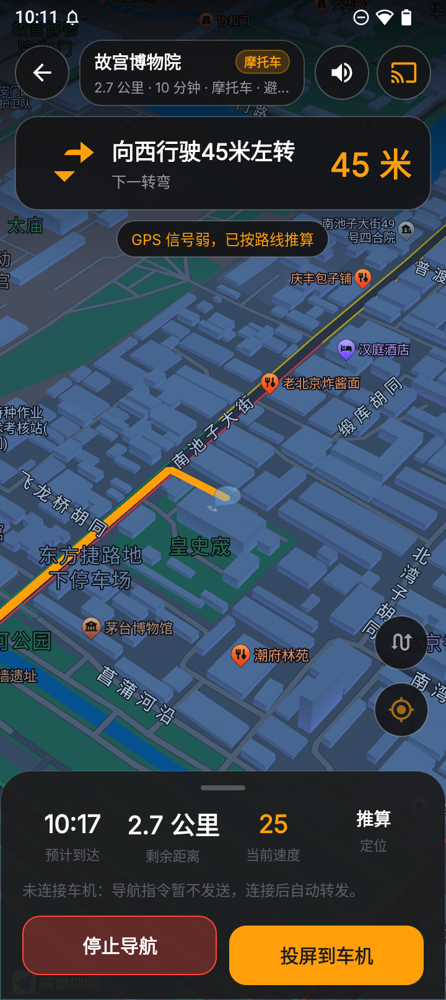
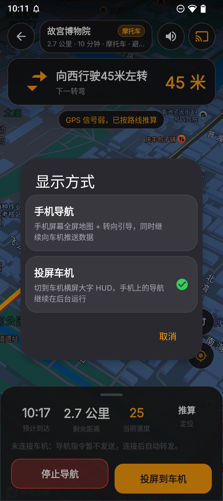
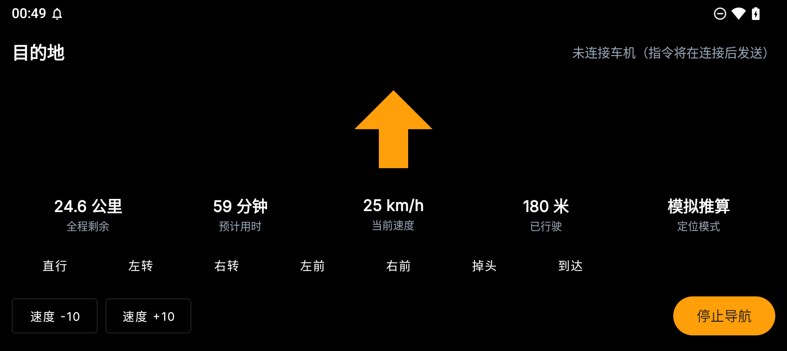
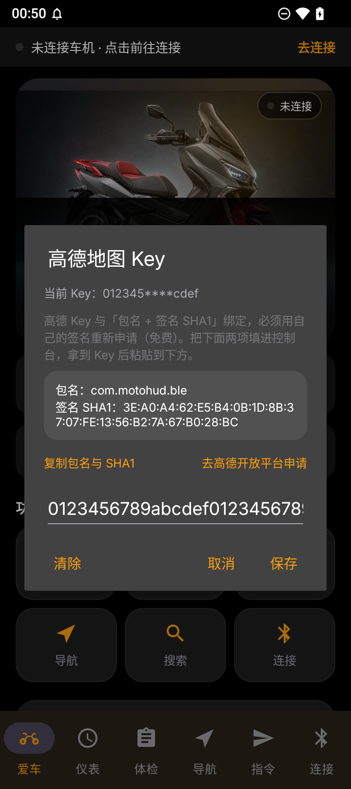

# 机车车机助手 · MotoHUD Bridge

面向**支持 BLE 车机互联的摩托车仪表**的 Android 工具：把手机的车辆数据、体检结果、导航信息，通过蓝牙推到车机屏幕上。

> 本项目独立开发，与任何整车厂商、车机厂商均无从属关系，也不包含其任何代码、图片或资源。

---

## 功能

| 模块 | 说明 |
| --- | --- |
| **爱车** | 首页：车型大图 + 场景光晕、油量/电压/水温/里程四个关键数据、功能宫格、整车参数与亮点标签；内置 8 款比亚乔集团车型，连接车机后按蓝牙名自动匹配，也可手动「换车」 |
| **连接** | 扫描并连接车机（自动过滤 `BYQ*` / `SR*` 与 `860745020*` 三类设备名），兼容双协议栈（FastBLE 服务 `00003719` + legacy GATT `0000ff33`），掉线自动重连 |
| **仪表** | 实时速度、转速、瞬时油耗、水温、环境温度、油量、电瓶电压、总里程、最大/平均速度 |
| **体检** | 开关状态位（ABS/OBD/电瓶/胎压/燃油/机油压力/保养/主控）+ ECU 故障码 + OBD 故障码 |
| **指令** | 按设备类型自动选择码表发送导航指令（转向图标 + 全程剩余 + 下一转弯剩余）、握手、到达、自定义文本、通知推送测试 |
| **导航** | 高德地图展示 + 目的地搜索（POI 输入提示）+ 路线规划 + 转向引导（TTS 播报）+ 3D 跟随；常用地址（家/公司/自定义）**点击即开始导航**；支持**摩托车 / 驾车**两种算路策略 |
| **手机导航** | 点搜索结果直接进入竖屏全屏导航页：转向横幅、全程剩余、预计到达、实时速度、定位质量、语音开关、全览/回中；与车机投屏**共用同一个导航引擎**，切来切去不中断 |
| **投屏** | 导航中「显示方式」一键切到横屏 HUD 大字体界面（手机端导航在后台继续跑），同时把转向图标与剩余距离实时写入车机（`REM/NEXT/NAVI` 或 `NA/RE/NE`），到达发 `FINISH`，退出发 `NO` |
| **检索** | 本地检索故障码、指令、关键词，带历史记录（低频功能，收进爱车页的二级入口） |
| **通知转发** | 可选：把微信/LINE/短信/来电推到车机提示（需手动授予通知使用权） |

首次启动提供 4 步新手引导（欢迎 → 隐私政策 → 如何连接车机 → 如何开始导航），之后可在「设置 → 重新查看新手引导」再次查看。

---

## 适用设备

- 具备 BLE 仪表 / 车机互联能力的摩托车，实测为**比亚乔（Piaggio）**系列随车 BLE 仪表；
- 连接页按设备名前缀自动识别：`BYQ*`、`SR*`，以及 MAC 前缀 `860745020*`；
- 其他品牌只要符合文末「协议要点」，改动 `ScanFragment` 的过滤规则即可适配。

---

## 车型库

内置 8 款车型，爱车页按车型展示大图与整车参数（排量、功率、扭矩、整备质量、座高、油箱、轮胎等）：

| 品牌 | 车型 |
| --- | --- |
| **APRILIA**（阿普利亚） | SR Max 250、SR Max 300、GPR 150、GPR 250 |
| **VESPA**（威斯帕） | Primavera 150、GTS 300 |
| **PIAGGIO**（比亚乔） | Beverly 300、Medley 150 |

- 连接车机后按蓝牙名自动匹配一次（`SR*` → SR Max、`GPR*` → GPR、`BYQ*` → Beverly 等），猜错可在「爱车 → 换车」里改；
- 车型数据在 [`BikeCatalog.kt`](app/src/main/java/com/motohud/ble/data/bike/BikeCatalog.kt)，新增车型只要加一条记录；
- 车型图放在 `app/src/main/assets/bikes/`，**同名替换即可生效**：

| 文件 | 对应车型 |
| --- | --- |
| `sr_max.png` | SR Max 250 / 300 |
| `gpr.png` | GPR 150 / 250 |
| `vespa.png` | Primavera 150 / GTS 300 |
| `beverly.png` | Beverly 300 / Medley 150 |

> 仓库内的车型图为**原创 AI 插画**（横版、深色棚拍背景、主体居中），避免直接使用厂商官网图的著作权与商标风险。
> 如果你有授权图片，替换同名文件即可；建议 ≥1280×854、主体居中、深色背景，页面会自动叠加光晕与底部压暗。

---

## 界面

暗色玻璃设计（tvOS 风格），主色 `#FF9F0A`：6 个页签（爱车 / 仪表 / 体检 / 导航 / 指令 / 连接）+ 顶部连接状态条
（灰点未连接 / 橙点连接中 / 绿点已连接并显示设备名），未连接的页签显示空态遮罩并提供「去连接」入口。

| 新手引导 | 连接引导 | 爱车（首页） |
| --- | --- | --- |
|  |  |  |

| 车辆参数 | 换车 | 仪表（未连接） |
| --- | --- | --- |
|  |  |  |

| 连接车机 | 地图与搜索 | 手机导航 | 显示方式 | 投屏 HUD |
| --- | --- | --- | --- | --- |
|  |  |  |  |  |

Key 申请时不用自己找 SHA1，应用内已经算好：



---

## 快速开始

### 1. 编译

```bash
# 需要 JDK 17、Python 3 与 Android SDK（compileSdk 36）

# ① 准备高德 SDK：下载 → 合并去重 → 解出 so 与 assets（SDK 不进仓库）
python tools/prepare_amap_sdk.py

# ② 编译
./gradlew assembleDebug
# 产物：app/build/outputs/apk/debug/app-debug.apk
```

首次编译前在项目根目录创建 `local.properties`：

```properties
sdk.dir=/path/to/Android/Sdk
amap.apiKey=你的高德Key      # 可选，也可在应用内填写
```

> 高德官方只把类 jar 发布到 Maven，`.so` 与 `assets` 都打包在 jar 内部，
> Gradle 不会自动处理，所以需要第 ① 步。SDK 版权归高德所有，仓库不分发。

### 2. 地图与搜索的 Key

地图、目的地搜索、路线规划由**高德开放平台** SDK 提供。

**Key 必须自己申请，无法复用别人的（包括旧版 App 的）。** 原因不在 SDK，而在高德服务端：
Android Key 与「包名 + 签名证书 SHA1」绑定，请求时 SDK 会把两者一起发给高德校验，
包名或签名对不上就返回 `INVALID_USER_KEY (10001)`。改包名、换签名之后，任何旧 Key 都会立刻失效。

申请免费、几分钟即可：

1. 打开 <https://lbs.amap.com>，注册个人开发者 → 创建应用 → 添加 Key → 选择 **Android 平台**；
2. 填包名 `com.motohud.ble` 与签名 SHA1 —— **应用内「设置 → 高德地图 Key」已经把你当前的包名和 SHA1 算好并支持一键复制**；
3. 到「服务管理」开通 **地图 SDK**、**搜索**、**定位** 三项；
4. 把 Key 粘贴回应用内的输入框，保存后立即生效。

未配置 Key 时：地图区域隐藏，POI 搜索不可用，但**蓝牙投屏导航仍可用**
（引擎按直线推算演示转向与剩余距离，方便验证车机链路）。

### 3. 使用

1. 摩托通电，车机进入可配对状态；
2. 「连接」页 → 扫描设备 → 点击目标设备；
3. 顶部状态条变绿即连接成功，爱车页显示实时数据，仪表 / 体检 / 指令页即时可用；
4. 「爱车 → 换车」可切换车型（首次连接会按车机名自动匹配）；
5. 「导航」页搜索目的地或点击「家 / 公司」→ 自动规划路线并进入**手机导航**；
6. 导航中点右上角「投屏」→ 选择「投屏车机」→ 车机屏幕显示转向图标与剩余距离，手机端导航在后台继续跑，返回即回到手机导航。

---

## 摩托车导航

**高德没有免费的摩托车算路。** 两条路都走不通：

- 导航 SDK（AMapNavi）的 `PathPlanningStrategy.MOTOR_MULTIPLE_*` 属于**收费接口**，
  要单独提交商务工单申请授权，未授权时算路直接失败；
- 本项目用的搜索 SDK（免费）`RouteSearch` 只有驾车 / 步行 / 骑行 / 公交，**没有任何摩托车策略**。

所以本 App 用「摩托车可达路网近似」：驾车算路，但策略固定为
`DrivingNoHighAvoidCongestionSaveMoney`（**不走高速 + 不走快速路 + 躲避拥堵**）。
国内禁摩/限行主要针对快速路、高架、隧道与部分主干道，避开快速路能绕开大部分硬禁区，
这也是骑行类 App 的通行做法。导航页常驻提示「摩托车能否上路以当地法规与现场禁摩标志为准」。

导航页右上角「摩托车 / 驾车」徽章可随时切换，切换后立即按新策略重算路线，不退出页面。
将来若拿到导航 SDK 商务授权，只需在 `NaviPrefs` 里把摩托车映射到 `MOTOR_MULTIPLE_DEFAULT`，上层无需改动。

---

## 定位精度（为什么以前会「漂移」）

「导航一直漂」不是单个 bug，是四层问题叠加，现在逐层处理：

| 层 | 问题 | 处理 |
| --- | --- | --- |
| 坐标系 | 系统 `LocationManager` 给 **WGS84**，地图与路线是 **GCJ02**，国内恒定差 300~700m | 所有系统定位帧统一 `wgs84ToGCJ()` 纠偏后再进引擎 |
| 定位源 | 系统 GPS 精度差、无速度航向；网络定位误差可达几百米 | 主用高德连续定位（GCJ02 + 多源融合 + 传感器辅助），**同时保留系统定位兜底**（高德 5s 无输出时接管） |
| 错点 | 冷启动第一帧常是网络/基站定位，一帧就能把车标甩到别的城市（地图看起来「白屏、路线不见了」） | 起点先 `seed()` 给滤波器打底；按 216km/h 上限做**物理不可能位移**判定，只有连续 3 帧且精度 ≤20m 才允许重新定上位 |
| 抖动/滞后 | 静止时坐标来回跳；行驶中强平滑导致越拖越远 | 速度自适应指数平滑（静止 α=0.12，跳变 α=0.85）；提供者不给速度时用位移/时间估算 |
| 画法 | 算路会把起点吸到最近道路，GPS 原始点常在路侧几十米，车标看着「不在路上」 | 车标按偏离距离分级吸附到路线（<4m 不吸、<15m 吸 0.5、<60m 吸 0.75） |

调试点：debug 包 `adb logcat -s NaviEngine` 会打印每帧 `off`（距路线偏移）/`snap`/`acc`（精度）。

---

## 权限说明

| 权限 | 用途 |
| --- | --- |
| 蓝牙（`BLUETOOTH_SCAN` / `CONNECT`，Android 12+） | 连接车机 |
| 定位（`ACCESS_FINE_LOCATION`） | 导航定位；Android 11 及以下扫描 BLE 也需要 |
| 通知（`POST_NOTIFICATIONS`） | 前台服务与到达提醒 |
| 通知使用权（可选） | 把手机通知转发到车机，需在系统设置中手动开启 |

车辆数据只在本地处理，不上传任何服务器；常用地址、搜索历史与车型选择都存在本机。

---

## 协议要点（便于适配其他车机）

下行帧：`[0..4) 命令 hex | [4..6) 数据长度 | [6..) 数据`

- `CMD_A` 开关位域、`CMD_B/C` 速度/转速/油耗/水温/油量/电瓶、`CMD_D` 里程、`CMD_E/F` 故障码
- 无效值一律 `fffe`

上行文本指令（`:` → `0x1E`，首尾 `0x0D`）：

- SR 类：`REM :全程剩余::`、`NEXT :下一转弯::`、`NAVI :图标::`
- BYQ 类：`NA`、`RE`、`NE`
- 握手：`HELLO :A:<品牌>:`
- 到达：`FINISH :::`；退出：`NO`

转向图标沿用高德 `IconType` 数值（直行 9 / 左转 2 / 右转 3 / 左前 4 / 右前 5 / 掉头 8 / 到达 15），
与主流导航软件的车机投屏数据一致。

---

## 目录结构

```
app/src/main/
├── assets/bikes/      车型插画（同名替换即可）
├── java/com/motohud/ble/
│   ├── amap/       高德 SDK 封装（Key/隐私合规、POI 提示、驾车路线规划）
│   ├── ble/        GATT 连接管理、协议编解码、导航指令
│   ├── data/       Room（常用地址、搜索历史）、故障码库、本地检索
│   │   └── bike/   车型库与车型选择持久化
│   ├── navi/       路线引导引擎、图标映射、坐标转换、指令转发器
│   ├── service/    通知转发服务
│   └── ui/         主界面（6 页签）、爱车页、导航页、导航中界面、新手引导
└── tools/          高德 SDK 准备脚本、车型图片处理脚本
```

---

## 免责声明

- 本项目为个人自用工具，按「现状」提供，不对车辆、车机或人身安全作任何保证。
- **骑行中请勿操作手机**；投屏信息仅供参照，实际路况以现场为准。
- 车机型号、固件差异可能导致部分指令无效，请先在静止状态验证。
- 车型参数来自公开资料整理，可能因年款、地区版本不同而存在差异，仅供参考。
- 地图与搜索服务由高德开放平台提供，可用性与配额以官方为准。

## 许可证

MIT，见 [LICENSE](LICENSE)。字体 Inter 依 SIL Open Font License 1.1 分发，见 [app/FONT-LICENSE-OFL.txt](app/FONT-LICENSE-OFL.txt)。
